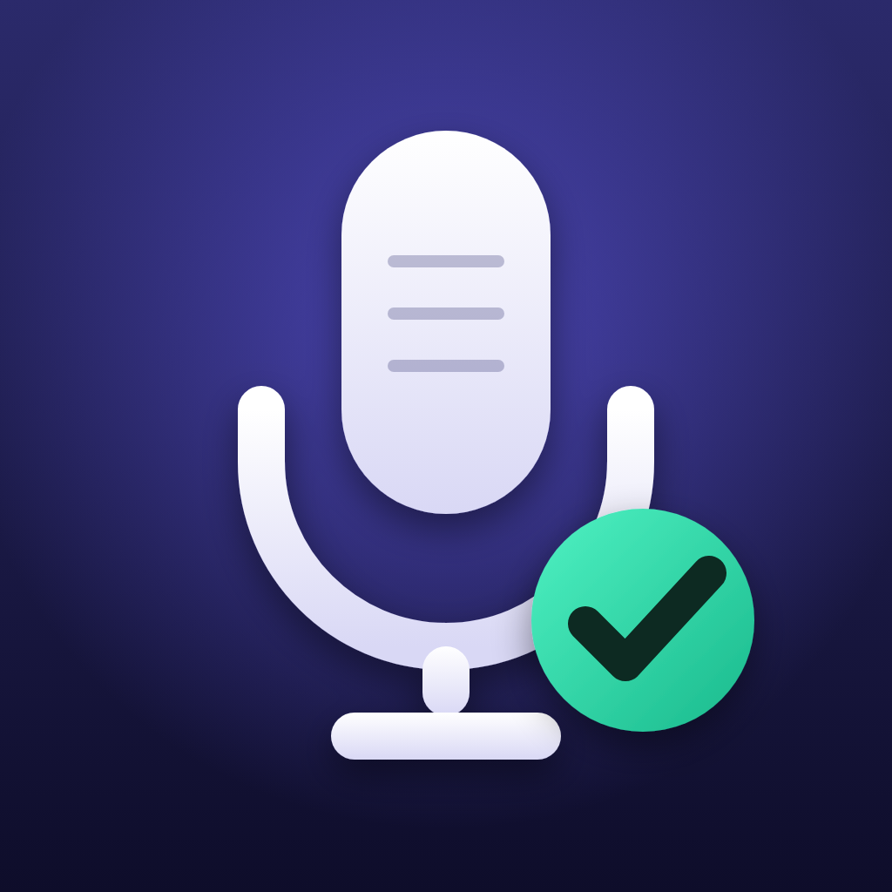

<div align="center">



# Glossa

**Mac dictation that spells your words right: Whisper, fed with your glossary and the text before your cursor, on the key you already press.**

[](https://github.com/pluginslab/glossa/releases/latest)
[](https://github.com/pluginslab/glossa/actions/workflows/ci.yml)
[](LICENSE)
[](#install)
[](https://swift.org)

</div>

You press the dictation key, say "redeploy the Next.js app with pnpm and check the
PostgreSQL logs in Grafana", and macOS types *"redeploy the next JS app with PNPM and check
the Postgres SQL logs in Grafana"*. Every time. There is no way to teach Apple's
dictation a word.

Whisper can be taught. It takes a short **prompt** before the audio, and anything in that
prompt, a vocabulary list or the sentence you were in the middle of, shapes how it spells
and punctuates what follows. Glossa builds that prompt on every dictation: your
**glossary** (one term per line) plus the **text before your cursor**, read through
Accessibility from whatever app you are in. Then it sends the audio to a Whisper server,
local by default, and types the answer where you were.

Same sentence, same model, with Glossa's prompt: *"redeploy the Next.js app with pnpm
and check the PostgreSQL logs in Grafana"*.

It lives in the menu bar, and it takes over the **microphone key** (F5 on Apple keyboards),
so nothing about how you dictate changes except the result.

## Install

With Homebrew, app and server in two commands:

```bash
brew install --cask pluginslab/tap/glossa   # the app, plus whisper.cpp
glossa-server                               # downloads large-v3-turbo (~550 MB), starts the launch agent on 127.0.0.1:8178
```

Or download the latest **Glossa DMG** from
[Releases](https://github.com/pluginslab/glossa/releases/latest), drag Glossa to
Applications, and run the same server setup from inside the app:

```bash
/Applications/Glossa.app/Contents/Resources/install-server.sh
```

Both are the same signed and notarized universal build for **macOS 14** or later. The
server is whisper.cpp's `whisper-server`, kept warm as a launch agent. You can skip it and
point Glossa at a server you already have (see [Remote servers](#remote-servers)).

macOS asks for two permissions the first time each is needed:

- **Accessibility**, for the key tap, for reading the text before your cursor, and for
  the paste. It is a toggle in System Settings → Privacy & Security → Accessibility, not
  a dialog; the menu-bar icon shows a crossed-out mic until it is on.
- **Microphone**, on your first dictation.

And two keyboard settings, so Apple's own dictation stops answering the key:

- System Settings → Keyboard → **Press 🌐 key to: Do Nothing**
- System Settings → Keyboard → Dictation → **Shortcut: Off**

## Usage

| Do this | Glossa |
| --- | --- |
| Press the **microphone key** | starts recording; press again to stop and transcribe |
| **Hold** the microphone key | push-to-talk: records while held, transcribes on release |
| **Double-tap Fn** | starts; any Fn tap stops |
| **Hold Fn** | push-to-talk |
| Fn + another key | ignored, so forward-delete and Fn-arrows still work |
| **Shift** + any of the above | a voice command: what you say becomes one shell command (below) |

Each moment has its own short sound, all from one family: notes rise when recording starts
and fall when it stops; dictation has a soft tone and voice commands a brighter one; a high
chord means the text or command is in, a low falling interval means something failed, a
rising one that the model asked a question, two equal notes a command worth checking, and a
quiet tick that the recording was too short or silent. `"sounds": false` turns them off.

The result lands a second or so after you stop, as if pasted. The text that was on your
clipboard is put back afterwards.

If music is playing when you start, the system volume drops by 10 points for the length of
the recording and comes back when you stop. Nothing happens when the output is silent, and
a volume you changed yourself in the meantime is left alone (`duckPercent`,
`duckOnlyIfPlaying`).

The menu-bar icon is a mic when idle, a red mic while recording (a red terminal for a voice
command), and an ellipsis while transcribing. The menu has *Start Recording* for mouse-only use, *Microphone* to pick the input when several are connected (or follow the system default), the glossary, the config,
and the log.

### Type While Speaking

With *Type While Speaking* checked in the menu, dictation appears as you talk instead of
after you stop. About every 0.8 seconds (`liveInterval`) the audio so far goes to Whisper
and the text in the app follows the answer: Glossa deletes only the part that changed
(Backspace) and types the new ending, so the last few words settle as you speak. Words two
passes in a row agree on stay put. A sentence Whisper closed with a full stop, question
mark or exclamation mark is locked as soon as you say more after it: it is never retyped,
and later passes only send the audio after it, so long dictations stay as quick as short
ones. Pauses send nothing. When you stop, a last pass over the unlocked end gives the final
text. (With a server that returns no timestamps, such as whisper.cpp's, each pass sends the
whole recording and skips the locked sentences.)

Backspaces are only safe while the cursor is where Glossa left it. If you click into another
field or app, or press a key yourself while talking, Glossa stops editing for that recording
and puts the full final text on the clipboard, with a notice. It works best in terminals and
plain text fields; apps that autocomplete or reformat as you type can confuse it. Voice
commands always wait for the whole sentence. Each recording sends several requests to the
server instead of one.

### Voice commands

Hold **Shift** while you press the microphone key (or while you hold or double-tap Fn) and
say what you want done: "show me the five biggest files here", "restart the nginx
container", "check out the branch from the last commit". Glossa transcribes it, sends the
request to a chat model with what it can see of the terminal, and pastes back **one
command, without Return**. You read it and press return yourself; nothing ever runs on its
own.

The context sent with the request: the frontmost app and its window title (Terminal and
iTerm2 put the folder or the ssh host there), the last 30 lines of the screen where the app
exposes them through Accessibility, and this Mac's host name, user and login shell. When
the screen shows an ssh session, the command is written for that machine.

It is one round. If the request is unclear or would mean guessing a path it can't see, the
model asks a short question instead, shown in a notice at the top of the screen. Commands
that delete files, use `sudo`, write to disks, force-push, reset or kill processes are
pasted with a warning in the same notice. *Start Voice Command* in the menu does the same
for mouse-only use.

**Your setup.** `~/.config/glossa/setup.txt` (*Edit Setup Notes…* in the menu) is sent
with every voice command: your servers and their ssh aliases, where projects live, your
shell helpers, which tools you prefer. Plain text, `#` lines ignored, read on every
command. With "web1 is the production box (ssh web1), the app runs in docker as app-web" in
it, "restart the app on production" becomes `ssh web1 'docker restart app-web'`. Keep
secrets out of it; it goes to the model.

It needs an OpenAI-style `/v1/chat/completions` endpoint. When `endpoint` is a
`/v1/audio/transcriptions` URL (llm-router, LiteLLM), the chat URL next to it is used with
the same key, so often nothing needs configuring; otherwise set `assistEndpoint`. The key
must be allowed to use `assistModel` (default `code`): a router key scoped to transcription
only needs a second key in `assistApiKey`. The prompt is the one Smart Terminal's voice
commands use.

### The glossary

`~/.config/glossa/glossary.txt`, one term per line, `#` for comments. Put in it whatever
Whisper gets wrong: product names, hostnames, colleagues, acronyms, the odd German word in
an English sentence. It is read on every dictation, so edits apply immediately. The
default file has a starter list to replace with your own.

Whisper's prompt holds about 220 tokens. The glossary goes first and the cursor context
last, so when the prompt is too long it is the start of the glossary that gets cut, not the
sentence you are continuing. Around 60 short terms is a comfortable size.

### Context from the cursor

Before recording, Glossa asks the focused app, through the Accessibility API, for the text
before the insertion point (up to `contextChars`, default 300) and appends it to the prompt.
Whisper then continues the sentence in the same register and vocabulary. Native Mac apps,
Electron apps and browsers generally expose this; most terminals do not, and then only the
glossary is sent. `"useContext": false` turns it off.

### Configuration

`~/.config/glossa/config.json`, created on first launch:

| Key | Default | |
| --- | --- | --- |
| `endpoint` | `http://127.0.0.1:8178/inference` | any OpenAI-style transcription endpoint |
| `apiKey` | `""` | sent as a Bearer token when set |
| `model` | `whisper-1` | the `model` form field; whisper-server ignores it, routers use it |
| `fallbackEndpoint` | `""` | a second server, used when `endpoint` fails or when *Use Fallback Server* is checked in the menu |
| `fallbackApiKey` | `""` | its key |
| `fallbackModel` | `whisper-1` | its model name |
| `primaryTimeout` | `10` | seconds of silence from `endpoint` before the fallback is tried |
| `language` | `en` | Whisper language code; `auto` works but costs ~0.5 s per request |
| `useContext` | `true` | read the text before the cursor |
| `contextChars` | `300` | how much of it |
| `sounds` | `true` | start / done / error sounds |
| `minSeconds` | `0.4` | shorter recordings are dropped |
| `micKeyCode` | `176` | the microphone key's code; `0` disables it |
| `duckPercent` | `10` | lower the output volume by this many points while recording; `0` disables it |
| `duckOnlyIfPlaying` | `true` | only when something is playing on the output device |
| `debug` | `false` | log Fn and special-key events |
| `liveInterval` | `0.8` | seconds between passes with *Type While Speaking* on |
| `silenceDB` | `-80` | a recording that never gets louder than this (dBFS) is not sent: the mic delivered silence |
| `assistEndpoint` | `""` | chat completions URL for voice commands; empty derives it from `endpoint` |
| `assistApiKey` | `""` | its key; empty uses `apiKey` |
| `assistModel` | `code` | the model (router alias) that writes the command |

### Remote servers

The request is the OpenAI `/v1/audio/transcriptions` shape (`file`, `model`, `prompt`,
`language`, `response_format`), so anything that speaks it works. Change `endpoint`,
`apiKey` and `model`, nothing else:

- a **LiteLLM** proxy with an `audio_transcription` model behind it
- **Speaches** (the former faster-whisper-server) on a GPU box
- **whisper.cpp** `whisper-server` on another machine (`--inference-path /v1/audio/transcriptions` makes its path match too)
- OpenAI or Groq, if you are fine with the audio leaving your network

Latency on an M-series Mac with the local server and large-v3-turbo is about 0.6 s per
sentence; the prompt itself costs almost nothing.

Plain `http://` to another machine works from 0.3.0 on (earlier versions could only
reach 127.0.0.1 without TLS). On a laptop that roams, prefer the server's Tailscale
address over its LAN address, so dictation works wherever you are.

**Two servers.** The usual setup on a laptop is a GPU box as `endpoint` and the local
whisper-server as the fallback:

```json
{
  "endpoint": "http://100.x.y.z:7576/v1/audio/transcriptions",
  "apiKey": "sk-…",
  "model": "transcribe",
  "fallbackEndpoint": "http://127.0.0.1:8178/inference"
}
```

When the GPU box does not answer within `primaryTimeout` seconds, or fails for any other
reason, the same recording goes to the fallback and the log says so. The menu shows
both servers and which one answered last. *Use Fallback Server* sends everything to the
fallback until you uncheck it, for when you know you are offline and would rather not
wait for the timeout.

## How it works

A session-wide CGEvent tap watches for the microphone key (it arrives as an ordinary key
event, code 176 with the Fn flag, not as a media key) and for Fn. The mic key event is
swallowed, which is what keeps Apple's "Do you want to enable Dictation?" dialog away.
Audio comes from `AVAudioEngine`, resampled to 16 kHz mono in memory. The transcription is
one multipart POST. Insertion is a pasteboard write and a synthetic ⌘V, the only way to
type into every app without being an input method. Details in
[CONTRIBUTING.md](CONTRIBUTING.md); what it reads and sends, in
[SECURITY.md](SECURITY.md).

## Roadmap

- **Live preview.** Whisper does not stream, but re-transcribing the audio so far every
  second or two and showing the interim text in a small floating window is cheap on Apple
  silicon. The final paste stays as it is.
- A per-app language override.

## Build

```bash
scripts/bundle.sh --open       # debug build, launched
scripts/bundle.sh --install    # release build into ~/Applications, relaunched
scripts/release.sh             # notarized universal DMG in dist/
```

Swift Package Manager only, no Xcode project. Xcode 26 (Swift 6.2) on macOS 14 or later.

## License

[MIT](LICENSE) © 2026 Pluginslab
